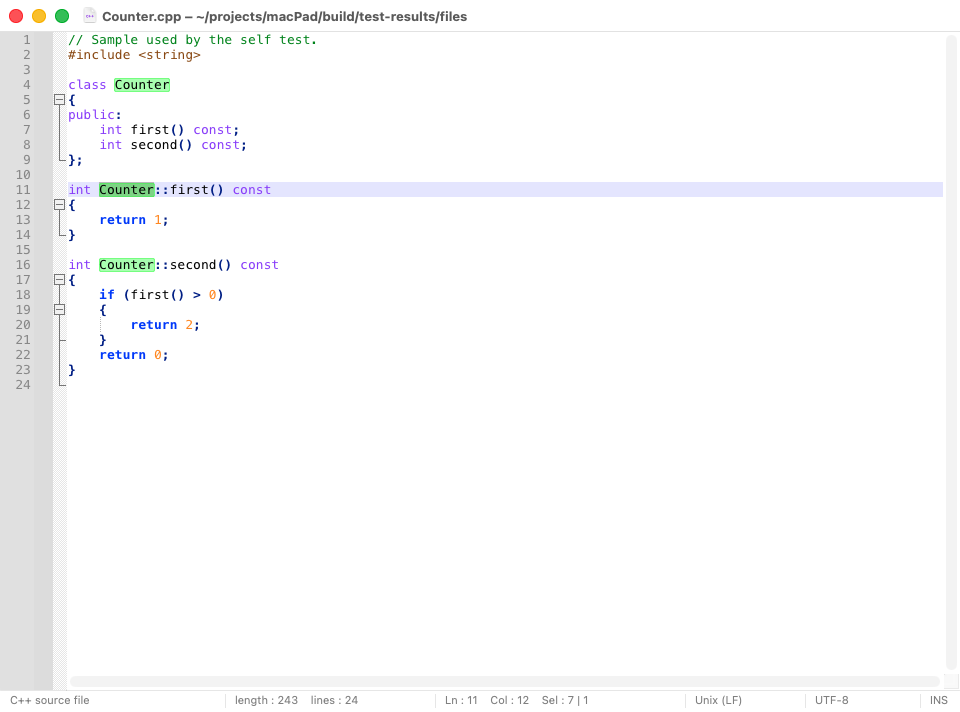
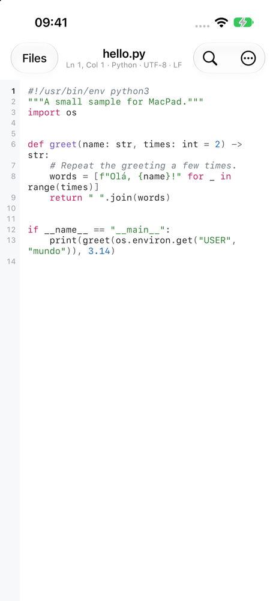

# MacPad

A fast, native text and code editor for the Mac, iPhone and iPad.

The Mac app is written in AppKit: native window tabs, menus, dark mode and the usual
macOS shortcuts. The iOS app opens files from Files and iCloud Drive and has a row of
coding keys above the keyboard. Both highlight about 100 languages with the same
engine and themes, open files in any common encoding, and never lose unsaved work.

| Mac | iPhone |
|---|---|
|  |  |

Leia em português: [README.pt-BR.md](README.pt-BR.md).

## Installing

### Mac

You need the Xcode command line tools (`xcode-select --install`). Nothing else is
downloaded: everything MacPad is built from is in this repository.

```bash
make install
```

This builds the app for your Mac and copies it to `/Applications`.

### iPhone and iPad

You need Xcode and an Apple ID. A free Apple ID is enough.

1. Open `ios/MacPad.xcodeproj` in Xcode.
2. In **Xcode > Settings > Accounts**, add your Apple ID if it is not there yet.
3. Select the **MacPad** project, the **MacPad** target, then **Signing & Capabilities**,
   and choose your team (with a free Apple ID: *Your Name (Personal Team)*).
   If Xcode says the bundle identifier is not available, change it to something of
   your own, such as `com.yourname.macpad`.
4. Connect the iPhone with a cable, choose it at the top of the Xcode window and press
   **Run** (⌘R).
5. The first time, the iPhone asks you to turn on **Developer Mode** (Settings > Privacy &
   Security) and to trust your certificate (Settings > General > VPN & Device Management).

With a free Apple ID the app keeps working for 7 days; connect the iPhone and press Run
again to renew it. A paid Apple Developer account makes it last a year.

## Features

**On both**

- Syntax highlighting for about 100 languages, picked from the file extension, the file
  name (`Makefile`, `.zshrc`) or the first line (`#!/usr/bin/env python3`, `<?xml`).
- 10 themes: Light, Dark, Paper, Sunrise, Ocean, Midnight, Forest, Graphite and two high
  contrast ones. *Automatic* follows the system's light or dark appearance.
- Encodings: UTF-8, UTF-8 with BOM, UTF-16 LE/BE, and legacy code pages detected
  automatically (Windows-1252, Shift-JIS, GB 18030, …). Convert to another encoding, or
  reopen a file with the encoding you choose. A character the encoding cannot store
  stops the save with an error; it is never dropped silently.
- CR LF, LF and CR line endings are detected, kept and can be converted.
- Line operations: sort (text, ignoring case, numeric), reverse, remove duplicates and
  empty lines, trim spaces, TAB↔space, duplicate and delete lines, toggle comments.
- Case conversions, checksums (MD5, SHA-1, SHA-256, SHA-512), Base64 and URL
  encode/decode, Format and Minify JSON (key order and numbers kept as written).
- Auto-indentation, and brackets and quotes that close themselves in source code.

**On the Mac**

- Documents open as native window tabs; a dot on the tab marks unsaved changes.
- **Session:** quitting never asks to save. Every open document, unsaved text included,
  is back at the next launch, and unsaved text is backed up a few seconds after each
  change. Turn this off in Settings to get the usual "save changes?" question.
- Find / Replace with Normal, Extended (`\n \r \t \0 \xHH \uHHHH`) and Regular expression
  modes; whole word, match case, wrap around, backward, in selection; Count and Mark All.
- **Find All** in the current or all opened documents, and **Find in Files** in a folder
  with file filters (`*.cpp *.h !*.min.js`), listed in the Search Results window.
- Multiple selections and column selection (Option-drag), Select Next Occurrence.
- Auto-completion from the language keywords and the words of the document.
- **Macros:** record typing, caret movement and menu commands; play them back once,
  N times, or until the end of the file.
- Code folding, bookmarks, change history in the margin, brace matching, highlighting
  of the selected word, Go to Line (`line:column`), Print.
- Settings (⌘,): font and size, line numbers, indent guides, current line highlight,
  vertical edge, word wrap, tab width, spaces or tabs.

**On iPhone and iPad**

- Opens, creates, renames and moves files in Files: iCloud Drive, On My iPhone (a
  *MacPad* folder is there) or any file provider. "Open in MacPad" works from other apps.
- Saves by itself, like other iOS apps; the last document comes back when you return.
- Line numbers with the current line in bold, and a status line with line, column,
  language, encoding and line ending.
- A row of keys above the keyboard: Tab, arrows, brackets, quotes and symbols, undo,
  redo and hide keyboard.
- The system's Find and Replace bar, Go to Line, text size, wrap or scroll long lines,
  Share and Print.
- With a hardware keyboard: ⌘F, ⌥⌘F, ⌘L, ⌘/, ⌘D, ⌘S, ⌘= / ⌘-, ⌘W.

## Keyboard shortcuts on the Mac

| Action | Shortcut |
|---|---|
| Settings | ⌘, |
| Find / Replace | ⌘F / ⌥⌘F |
| Find next / previous | ⌘G / ⇧⌘G |
| Find in Files | ⇧⌘F |
| Search Results window | F7 |
| Select next / all occurrences | ⌥⌘E / ⌃⌘G |
| Go to line (accepts `line:column`) | ⌘L |
| Go to / select to matching brace | ⌘B / ⇧⌘B |
| Complete word | ⌃Space |
| Duplicate line | ⌘D |
| Delete line | ⇧⌘K |
| Move line up / down | ⌥⌘↑ / ⌥⌘↓ |
| Join lines | ⌃⌘J |
| Insert blank line above / below | ⌥⌘↩ / ⌥⇧⌘↩ |
| Toggle line / block comment | ⌘/ / ⌥⌘/ |
| UPPERCASE / lowercase | ⇧⌘U / ⌘U |
| Fold / unfold current level | ⌥⌘← / ⌥⌘→ |
| Fold all / unfold all | ⌥⇧⌘← / ⌥⇧⌘→ |
| Toggle / next / previous bookmark | ⌘F2 / F2 / ⇧F2 |
| Zoom in / out / reset | ⌘= / ⌘- / ⌘0 |
| Start or stop recording a macro | ⌃⌘R |
| Play back the macro | ⌃⌘P |
| Save all / close all | ⌥⌘S / ⌥⌘W |
| Print | ⌘P |

If you use more than one keyboard input source, macOS may reserve ⌃Space for switching
between them; change that in **System Settings > Keyboard > Keyboard Shortcuts > Input
Sources**.

## Good to know

- **Regular expressions.** Find and Replace in the Mac editor use ECMAScript syntax, with
  `\1` in replacements. Find in Files uses ICU, the regular expressions of macOS.
- **Find in Files reads from disk.** Unsaved changes are not searched there; use *Find
  All in All Opened Documents* for those.
- **Macros** (Mac) are kept until you quit. They cannot be named or saved yet.
- **On iOS** the text is edited with plain line breaks; the file's own line ending is
  restored when it is saved. Texts above 2 MB are shown without colours.
- **Files above 64 MB** open on the Mac as plain text, without the features that scan
  the whole document. Files above 2 GB cannot be opened.

Not available yet: macros, Find in Files, auto-completion and font choice on iOS;
plugins, user-defined languages, split view, a document map, a function list, a folder
sidebar, Replace in Files, call tips, a column editor, a theme editor, custom shortcuts,
localization (the interface is in English) and automatic updates.

## Building and testing

```bash
make                # build/MacPad.app for this Mac's architecture
make run            # build and open the Mac app
make test           # end-to-end self test of the Mac app
make install        # copy the Mac app to /Applications
make UNIVERSAL=1    # Apple silicon + Intel
make dist           # universal build packed as build/MacPad-<version>.dmg and .zip
make ios            # build the iOS app for the simulator
make ios-test       # run the iOS tests on a simulator (IOS_SIMULATOR="iPhone 17")
make ios-project    # regenerate ios/MacPad.xcodeproj after changing ios/project.yml
make clean
```

`make test` links a test driver into a copy of the Mac app with its own bundle
identifier, so your settings and session are untouched. It opens windows for about a
minute, quits the app with unsaved documents, starts it again to check that they come
back, and writes `build/test-results/log.txt` plus screenshots. It also checks that
the highlighter used on iOS colours text byte for byte like Scintilla on the Mac.

The iOS project is generated from `ios/project.yml` with
[XcodeGen](https://github.com/yonaskolb/XcodeGen) (`brew install xcodegen`); the
generated project is kept in the repository, so Xcode alone is enough to build it.

## Languages and themes

Everything the editors know about languages and colours is in `data/`:

| File | Contents |
|---|---|
| `data/languages.json` | Every language: name, extensions, file names, `#!` interpreters, comment tokens, Lexilla lexer, keyword lists and lexer properties |
| `data/stylemap.json` | For each Lexilla lexer, the role of each of its styles: `comment`, `keyword`, `string`, `number`, … |
| `data/themes/*.json` | Themes: editor colours, and a colour, bold, italic or underline for each role |

A theme only colours roles, so it works for every language. To make a theme, copy one
from `data/themes/`, rename it and change the colours; it appears in the theme menus
after the next build. Roles a theme leaves out borrow from a related one (doc comments
look like comments, regular expressions like strings, …).

`languages.json` and `stylemap.json` are generated by `tools/gen-data.py`, which holds
the language list and takes keyword lists from SciTE's `.properties` files:

```bash
curl -O https://www.scintilla.org/scite569.tgz && tar -xzf scite569.tgz
tools/gen-data.py scite/src
```

## Where MacPad keeps its data

| What | Where |
|---|---|
| Mac settings | `~/Library/Preferences/dev.macpad.editor.plist` |
| Mac session and backups of unsaved text | `~/Library/Application Support/dev.macpad.editor/` |
| iOS documents | wherever you keep them in Files; MacPad's own folder is *On My iPhone > MacPad* |

To reset the Mac app, quit it, run `defaults delete dev.macpad.editor` and move the
Application Support folder above to the Trash.

## Source layout

| Path | Purpose |
|---|---|
| `src/` | Mac app (AppKit + Scintilla): windows, menus, documents, Find panel, session, macros |
| `ios/` | iOS app (UIKit): document browser, editor, settings; `ios/Tests` are its tests |
| `shared/` | Code of both apps: languages, themes, highlighting without Scintilla, encodings, search, completion, text tools |
| `data/` | Languages, style map and themes |
| `test/SelfTest.mm` | Self test of the Mac app (`make test`) |
| `tools/` | Data generator, icon generator, vendor update script |
| `resources/` | App icon and acknowledgements |
| `vendor/` | Scintilla and Lexilla, unchanged (see `vendor/README.md`) |

## License

MacPad is free software, released under the
[GNU General Public License, version 3 or later](LICENSE).
It is built with [Scintilla and Lexilla](https://www.scintilla.org/); their license
notice is in `vendor/` and in the apps (Help > Acknowledgements on the Mac, About
MacPad on iOS).
