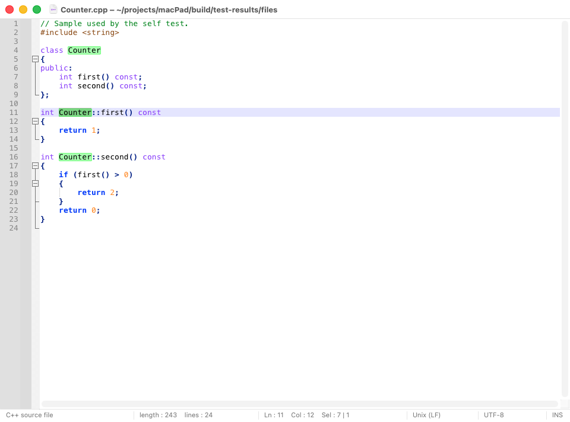
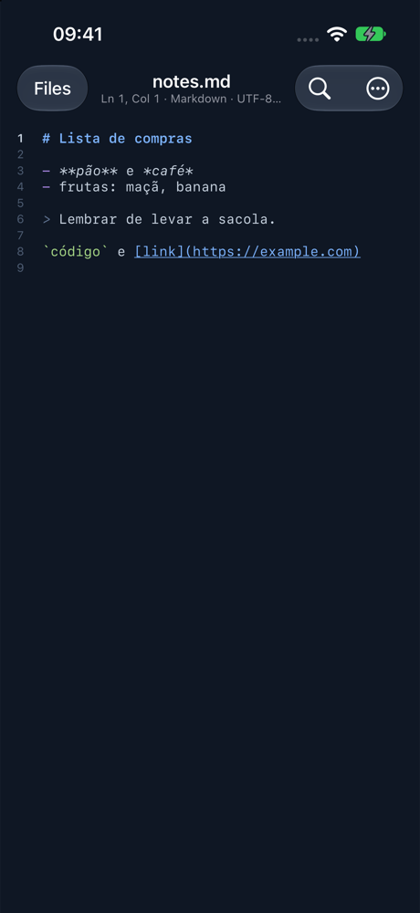

# MacPad

Um editor de texto e código nativo e rápido para Mac, iPhone e iPad.

O app de Mac é feito em AppKit: abas nativas, menus, modo escuro e os atalhos do macOS.
O app de iOS abre arquivos do app Arquivos e do iCloud Drive e tem uma fileira de teclas
de programação acima do teclado. Os dois realçam cerca de 100 linguagens com o mesmo
motor e os mesmos temas, abrem arquivos nas codificações mais comuns e não perdem
trabalho não salvo.

| Mac | iPhone |
|---|---|
|  |  |

A documentação completa (atalhos, formato dos temas, estrutura do código) está em
inglês: [README.md](README.md). A interface dos apps também está em inglês.

## Instalar no Mac

Você precisa das ferramentas de linha de comando do Xcode (`xcode-select --install`).
Nada mais é baixado: tudo de que o MacPad precisa está neste repositório.

```bash
make install
```

Isso compila o app para o seu Mac e o copia para `/Applications`.

## Instalar no iPhone ou iPad

Você precisa do Xcode e de um Apple ID. Um Apple ID gratuito basta.

1. Abra `ios/MacPad.xcodeproj` no Xcode.
2. Em **Xcode > Settings > Accounts**, adicione seu Apple ID, se ainda não estiver lá.
3. Selecione o projeto **MacPad**, o alvo **MacPad**, depois **Signing & Capabilities**, e
   escolha seu time (com Apple ID gratuito: *Seu Nome (Personal Team)*). Se o Xcode
   disser que o identificador não está disponível, troque por um seu, como
   `com.seunome.macpad`. Para o time não se perder quando o projeto for gerado de novo
   (`make ios-project`), coloque-o em `ios/Local.xcconfig`, como explica
   `ios/Signing.xcconfig`.
4. Conecte o iPhone com o cabo, escolha-o no topo da janela do Xcode e clique em **Run**
   (⌘R).
5. Na primeira vez, o iPhone pede para ativar o **Modo de Desenvolvedor** (Ajustes >
   Privacidade e Segurança) e para confiar no seu certificado (Ajustes > Geral > VPN e
   Gerenciamento de Dispositivos).

Com Apple ID gratuito, o app funciona por 7 dias; depois disso, conecte o iPhone e clique
em Run de novo para renovar. Com uma conta paga do Apple Developer, dura um ano.

## Principais recursos

**Nos dois**

- Realce de sintaxe para cerca de 100 linguagens, escolhida pela extensão, pelo nome do
  arquivo (`Makefile`, `.zshrc`) ou pela primeira linha (`#!/usr/bin/env python3`).
- 10 temas próprios; *Automatic* segue o modo claro ou escuro do sistema.
- Codificações UTF-8, UTF-16 e páginas de código antigas detectadas automaticamente
  (Windows-1252, Shift-JIS, …), com conversão e reabertura em outra codificação. Finais
  de linha CR LF, LF e CR detectados, mantidos e convertíveis.
- Operações de linha (ordenar, inverter, remover duplicadas e vazias, aparar espaços,
  TAB↔espaço, comentar), maiúsculas e minúsculas, MD5/SHA, Base64, URL, formatar e
  minificar JSON.
- Autoindentação, e parênteses e aspas que fecham sozinhos em código-fonte.

**No Mac**

- iCloud Drive: documentos novos ficam em iCloud Drive › MacPad e os documentos do iCloud
  Drive se salvam sozinhos, para o iPhone e o iPad terem tudo (veja abaixo).
- Abas nativas; sair não pergunta se quer salvar, porque tudo, incluindo o texto não
  salvo, volta na próxima abertura (dá para desligar em Settings).
- Buscar e substituir com expressões regulares, Find All e Find in Files em uma pasta.
- Seleção múltipla e em coluna, autocompletar, macros, dobra de código, marcadores,
  histórico de alterações na margem, impressão.

**No iPhone e iPad**

- Abre, cria, renomeia e move arquivos no app Arquivos: iCloud Drive, No Meu iPhone (há
  uma pasta *MacPad* lá) ou qualquer outro provedor. "Abrir no MacPad" funciona a partir
  de outros apps.
- Salva sozinho, como os outros apps de iOS; o último documento reabre quando você volta.
- Números de linha e uma linha de status com linha, coluna, linguagem, codificação e final
  de linha.
- Fileira de teclas acima do teclado: Tab, setas, chaves, aspas e símbolos, desfazer,
  refazer e esconder o teclado.
- Buscar e substituir do próprio iOS, Ir para a linha, tamanho do texto, quebra de linhas
  longas, compartilhar e imprimir.

Ainda não existem no iOS: macros, Find in Files, autocompletar e escolha de fonte.

## Os mesmos documentos no Mac e no iPhone

O MacPad usa o iCloud Drive para isso, o que funciona com Apple ID gratuito. O iCloud Drive
precisa estar ligado no Mac (Ajustes do Sistema > seu nome > iCloud) e no iPhone ou iPad.

- **No Mac**, *Sync with iCloud Drive* vem ligado em Settings > General. Um documento novo
  vira um arquivo em **iCloud Drive › MacPad** uns dois segundos depois que você para de
  digitar (`new 1.txt`, `new 2.py`, …; File > Rename… dá um nome a ele). Todo documento
  que está no iCloud Drive é salvo assim, e mais uma vez ao sair, então não há o que
  salvar à mão. File > Open from iCloud… (⇧⌘O) mostra essa pasta.
- **No iPhone ou iPad**, abra o MacPad, escolha **Browse > iCloud Drive > MacPad** (a
  interface do app é em inglês) e abra o documento. Lá o MacPad também salva sozinho.
- Uma alteração chega ao outro aparelho quando o iCloud a sincroniza, em geral de segundos
  a um minuto. Um documento aberto a mostra sozinho. No Mac, se você também tiver
  alterações não salvas, o MacPad pergunta qual versão manter.
- Se o mesmo documento for alterado nos dois aparelhos antes de o iCloud sincronizar, as
  duas versões são mantidas: a janela mostra uma e a outra é salva ao lado como
  `nome (aparelho).ext`. Quando o iPhone só tem acesso ao próprio arquivo, essa cópia vai
  para No Meu iPhone › MacPad. O MacPad diz onde a cópia ficou.
- Arquivos em outros lugares do Mac são salvos à mão, como sempre. Para ter um deles no
  iPhone, use File > Move To… e escolha iCloud Drive › MacPad.

Os ajustes (tema, fonte, tabulação) são de cada aparelho. Handoff e ajustes compartilhados
pelo iCloud exigiriam a conta paga do Apple Developer Program, por isso o MacPad não os usa.

## Compilar e testar

```bash
make                # build/MacPad.app para a arquitetura deste Mac
make run            # compila e abre o app de Mac
make test           # teste automático de ponta a ponta do app de Mac
make install        # copia o app de Mac para /Applications
make ios            # compila o app de iOS para o simulador
make ios-test       # roda os testes do iOS no simulador
```

## Página e versões publicadas

`docs/index.html` é a página do projeto, em inglês e português. O GitHub Pages a publica
a partir da pasta `docs` da `main` (Settings > Pages > Deploy from a branch > `main` /
`/docs`). O botão "Baixar para Mac" aponta para a última release, que o
`.github/workflows/release.yml` cria quando uma tag de versão é enviada
(`git tag v0.2.0` e `git push origin v0.2.0`).

## Onde o MacPad guarda seus dados

| O quê | Onde |
|---|---|
| Configurações (Mac) | `~/Library/Preferences/dev.macpad.editor.plist` |
| Sessão e backups do texto não salvo (Mac) | `~/Library/Application Support/dev.macpad.editor/` |
| Documentos do Mac e do iPhone | iCloud Drive › MacPad |
| Documentos (iOS) | onde você os guardar no app Arquivos; a pasta do app é *No Meu iPhone > MacPad* |

## Licença

O MacPad é software livre, distribuído sob a
[GNU General Public License, versão 3 ou posterior](LICENSE).
Ele é construído com [Scintilla e Lexilla](https://www.scintilla.org/); o aviso de
licença deles está em `vendor/` e nos apps.
